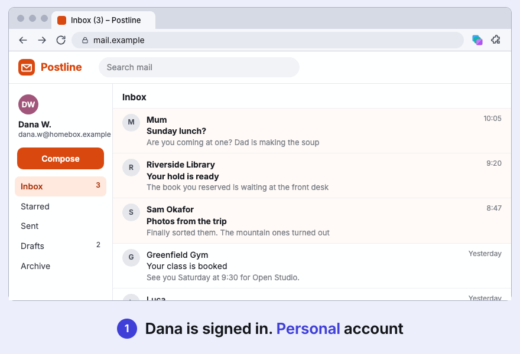
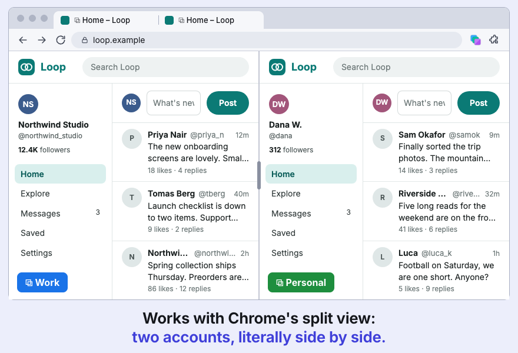
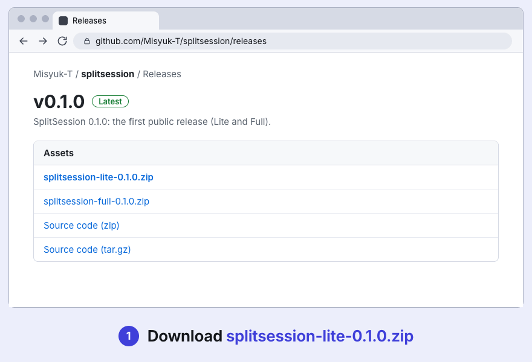

# SplitSession

**Same site, separate logins.**



[](https://github.com/Misyuk-T/splitsession/actions/workflows/ci.yml)
[](LICENSE)
[](https://www.npmjs.com/package/splitsession-bridge)
[](https://misyuk-t.github.io/splitsession/)
[](https://ko-fi.com/tomashdev)

SplitSession is an open-source Manifest V3 extension that brings Firefox-style containers to Chrome. Keep several accounts of the same site open **side by side, in different tabs of one Chrome profile**: two Reddit accounts, a work and a personal Supabase, all logged in at the same moment, with no second profile and no second browser. Each container has its own cookies and page storage; a tab belongs to one container, and everything that tab does happens inside it.

It also works with Chrome's split view: two accounts of one site, literally side by side. Two tabs of different containers in one split view are taken out of their groups and keep their own accounts (marked ⧉). (The picture composes two real container tabs; a split view cannot be scripted.)



## Features

- **Containers**: a name, a colour and a cookie jar per container.
- **Cookie and storage isolation** per tab: network cookies, `localStorage`, IndexedDB and more; popups stay in their container.
- **Tab groups** named after containers, kept in sync both ways.
- **Restore after restart**: container tabs come back in their containers.
- **Domain rules** ("always open this site in X") and an optional **strict mode** against service workers.
- **Export / import**, light and dark themes, keyboard-accessible UI.

More detail: [docs/features.md](docs/features.md).

## Lite and Full

| | **Lite** | **Full** |
| --- | --- | --- |
| Containers, isolation, tab groups, rules, restore, export / import | yes | yes |
| Local AI agent bridge (MCP), off by default | no | yes |
| Extra permissions | none | `nativeMessaging`, `debugger` |
| Where | Chrome Web Store, GitHub Releases | GitHub Releases |

Lite is the Chrome Web Store edition. Full adds the agent bridge; its code is not compiled into Lite.

## Install

**Chrome Web Store:** coming soon.

**From GitHub Releases** (Lite or Full):



1. Download `splitsession-lite-<version>.zip` or `splitsession-full-<version>.zip` from [Releases](https://github.com/Misyuk-T/splitsession/releases) and unzip it.
2. Open `chrome://extensions` and turn on *Developer mode*.
3. Choose *Load unpacked*.
4. Select the unzipped folder.

To build from source, see *Development* below.

## Quick start

1. Click the SplitSession toolbar button and press **+** to create a container, say "Work". Its first tab opens in it.
2. Log in to a site there. Create a second container, open the same site, and log in as someone else. Both stay logged in.
3. Use the popup's swap button to reopen any tab in another container, or add a **domain rule** in Settings so a site always opens in the right one.

## More

<details>
<summary><b>AI agents (Full edition)</b> — let Claude Code, Codex or Cursor see and use your tabs</summary>

<br>

The Full edition has an optional local MCP server that lets your own agent (Claude Code, Codex, Cursor and others) list your Chrome tabs with their containers and operate them: snapshots, trusted clicks and typing, screenshots, console and network, opening pages in a container. It is **off by default** and one all-or-nothing switch in Settings.

```sh
npx splitsession-bridge install   # then switch on "Agent bridge" in Settings > "For AI agents"
```

Tools, security model and client options: [docs/agents.md](docs/agents.md).

</details>

<details>
<summary><b>Security and limits</b> — what is and isn't isolated</summary>

<br>

SplitSession separates accounts on the same site; it is not a privacy tool and not a sandbox. It sends nothing anywhere ([privacy policy](docs/privacy.md)).

- The HTTP cache, HTTP auth, fingerprint, saved passwords and history are **not** isolated.
- One documented residual hole (same-origin frames and popups during navigation): [docs/commit-gap.md](docs/commit-gap.md).
- Not verified on many real sites yet. Full list: [docs/limits.md](docs/limits.md). How it works: [docs/how-it-works.md](docs/how-it-works.md).

</details>

<details>
<summary><b>Development</b> — build, test, editions</summary>

<br>

Node 22+ and pnpm 10.

```sh
pnpm install
pnpm dev            # WXT dev mode with a throwaway Chrome profile (pnpm dev:lite for Lite)
pnpm build          # Full -> .output/chrome-mv3
pnpm build:lite     # Lite -> .output/lite/chrome-mv3, plus the bundle check
pnpm test           # unit tests; pnpm e2e runs Playwright in real Chromium
pnpm lint && pnpm format:check && pnpm typecheck
```

Layout, editions, the end-to-end stand and releases: [docs/development.md](docs/development.md). All documents: [docs/README.md](docs/README.md).

</details>

## Support

SplitSession is free and MIT-licensed. If it saves you a second browser profile, you can [buy me a coffee on Ko-fi](https://ko-fi.com/tomashdev).

## License

[MIT](LICENSE).
