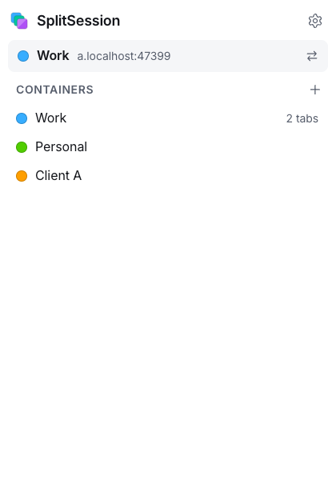
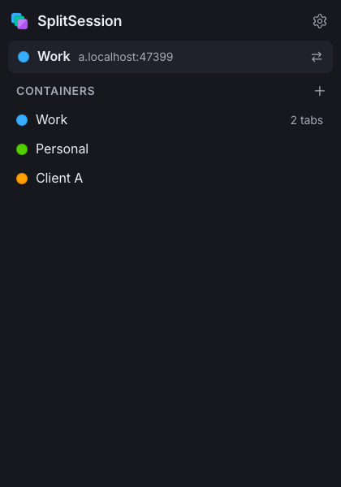
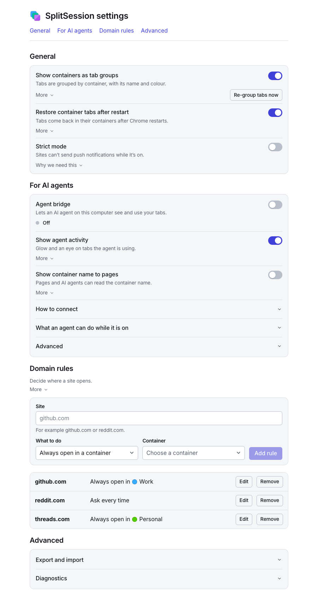

# SplitSession

**Same site, separate logins.**

[](https://github.com/Misyuk-T/splitsession/actions/workflows/ci.yml)
[](LICENSE)

SplitSession is an open-source Manifest V3 extension that brings Firefox-style containers to Chrome. Keep several accounts of the same site open **side by side, in different tabs of one Chrome profile**: two Reddit accounts, three Threads accounts, a work and a personal Supabase, all logged in at the same moment, with no second profile and no second browser.

Each container has its own cookies and its own page storage. A tab belongs to one container, and everything that tab does, on every site it visits, happens inside it.

<p>
  
  
</p>

<p>
  
</p>

## Why

Chrome profiles isolate everything, but each one is a separate window with its own extensions, bookmarks and history. Switching profiles to answer a client's account, then back, gets old quickly, and an AI agent that drives "your browser" can see only one of them.

Containers isolate only what identifies you to a site (cookies and page storage) and leave the rest of the profile shared. You pick the account per tab, not per window.

## Features

- **Containers**: a name, a colour (8 to choose from) and a cookie jar. Create, rename, recolour, delete.
- **Isolation of cookies and storage**: per-tab cookie jars for all network requests of the tab (frames, `fetch`, XHR, WebSocket handshakes), and per-container `document.cookie`, `localStorage`, `sessionStorage`, IndexedDB, Cache Storage and `BroadcastChannel`. Popups and links opened from a container tab stay in it.
- **Tab groups**: containers show up as Chrome tab groups titled `⧉ name` in the container's colour (optional). Renaming or recolouring such a group renames or recolours the container, and a tab dragged into a group is reopened in that container, so the group never lies about where a tab is. A container tab that is outside its group (dragged out, or tab groups off) gets `⧉ ` in front of its title, so it does not pass for an ordinary tab (optional; no container name in it, but sites can read titles).
- **Restore after restart**: with "Continue where you left off", Reopen closed tab, History or a reopened tab group, container tabs come back in their containers. Tabs SplitSession cannot match with certainty wait for you in the popup.
- **Domain rules**: per site, "always open in container X" or "ask me" (like Firefox's "Always open in").
- **Strict mode** (off by default): removes every service worker of the profile and refuses new ones, so none can answer a container tab with your regular logins. The price is push notifications on every site.
- **Export and import** of containers and rules as JSON. Cookies are left out unless you tick a clearly marked box.
- **Links and bookmarks**: `open.html?container=…&url=…` and a `#ctr=name` marker open a page in a container.
- Light and dark themes; every control is custom and keyboard accessible.

### Lite and Full

One codebase, two builds. **Lite** is containers only and is the edition for the Chrome Web Store (listed as *SplitSession: Multiple Logins per Site*). **Full** adds a local AI agent bridge.

| | **Lite** | **Full** |
| --- | --- | --- |
| Containers, isolation, strict mode, domain rules, tab groups, restore, export / import, `open.html` and `#ctr=` | yes | yes |
| Agent bridge (native messaging, MCP server, Chrome DevTools Protocol), off by default | not in the bundle | yes |
| Agent activity display (glow, label, tab-title mark, "AI" badge) | not in the bundle | yes |
| "Show the container name to pages" (`data-ctr`, `[name]` title prefix), off by default | not in the bundle | yes |
| Extra permissions | none | `nativeMessaging`, `debugger` |
| Extension ID | assigned by the Web Store (a local build gets a path-derived one) | fixed: `hapfikidacgfgnnajkgnaednpgnhmffk` |
| Build output | `.output/lite/chrome-mv3` | `.output/chrome-mv3` |

Lite is not a Full build with the settings hidden: the agent code is not compiled into it, and `scripts/check-lite.mjs` fails the Lite build if any bridge, CDP or native-messaging marker, or any of the three Full-only permissions, ends up in the bundle. The two editions have different IDs and can be installed side by side, but do not run both on the same sites at once: each would isolate its own tabs.

## Install

SplitSession is **not in the Chrome Web Store yet**, and there is no GitHub release yet. Until there is, build it from source. Pick an [edition](#lite-and-full) first: Lite unless you want the agent bridge.

**From a release zip** (once releases exist). A GitHub release carries `splitsession-lite-<version>.zip` and `splitsession-full-<version>.zip`. Unzip one, open `chrome://extensions`, turn on *Developer mode*, choose *Load unpacked* and select the unzipped folder. CI also attaches both zips to every run.

**From source** (Node 22+, pnpm 10):

```sh
pnpm install
pnpm build:lite     # Lite -> .output/lite/chrome-mv3 (and the bundle check)
pnpm build          # Full -> .output/chrome-mv3
```

Then *Load unpacked* on the folder of the edition you want.

SplitSession requests access to all sites, because rewriting request headers per tab needs it. It sends nothing anywhere. Containers and cookie jars live in `chrome.storage.local` on your machine, unencrypted (as do Chrome's own cookies); full-disk encryption is what protects both.

## Quick start

1. Click the SplitSession toolbar button and press **+** to create a container, say "Work". Its first tab opens in it.
2. Log in to a site in that tab. Create a second container, open the same site there, and log in as someone else. Both stay logged in.
3. For any tab, use the popup's swap button to reopen it in another container (or in none), or add a **domain rule** in Settings so a site always opens in the right one.

## How it works

1. A container belongs to a **tab** (`tabId -> container`), not to a site, so everything the tab requests, on any host, is in its container.
2. For a container's tabs, `declarativeNetRequest` session rules replace the `Cookie` request header with the container's jar and strip `Set-Cookie` from responses. The profile's real cookies are neither sent nor changed. The rules follow `SameSite`.
3. `Set-Cookie` headers are read in `webRequest` before the rules remove them, and stored in the container's jar.
4. A script that runs before the page's own scripts learns its container synchronously and namespaces cookie, storage, IndexedDB, Cache Storage and `BroadcastChannel` access per container.
5. Pages that a container tab opens (`window.open`, `target=_blank`) are created blank, put in the same container, and only then navigated, so even the first request of an OAuth popup is isolated.
6. Service workers and shared workers make requests outside any tab's rules, so they are switched off in containers; strict mode extends that to the whole profile.
7. The content scripts are registered only while containers are in use, so in a profile with none, ordinary pages are untouched.
8. A tab without a container is an ordinary Chrome tab.

The reasoning behind each choice is in [docs/decisions.md](docs/decisions.md).

## Security and limits

SplitSession separates accounts on the same site; it is not a privacy tool and not a sandbox. Read these before trusting it with anything important.

- **Isolated**: network cookies of the whole tab, the page storage APIs above, popups and links from a container tab, several accounts of one site at once.
- **Not isolated**: the HTTP cache, HTTP auth, client certificates, browser fingerprint, saved passwords and history. The first request of a tab SplitSession did not open itself can go out as the real profile before it is moved into its container.
- **A known hole**: a site that deliberately polls its own same-origin iframe or popup while it navigates can read the real profile's cookies and storage of that origin in the instant before SplitSession's scripts run. No extension API closes this; it can link accounts on that one site only. It is documented and not fixed on purpose: [docs/commit-gap.md](docs/commit-gap.md) (Ukrainian).
- **Not verified on real sites yet.** The isolation engine and the interface are covered by unit tests and by an end-to-end suite that runs real Chromium against a local multi-host stand imitating the usual login patterns (302 and XHR logins, HttpOnly cookies, OAuth by redirect and by popup, cross-origin iframes). Real sites bring service workers, anti-abuse checks and fingerprinting that the stand does not have, and some may notice two sessions from one browser.

The complete list, with the mechanism behind each item, is [docs/limits.md](docs/limits.md).

## AI agents (Full edition)

The Full edition has an optional **agent bridge**: a local MCP server that lets your own agent (Claude Code, on the same machine) list your Chrome tabs with their containers and operate them. It uses Chrome's debugger API for accessibility snapshots, trusted clicks and typing, file uploads, dialogs, screenshots of background tabs, console and network, `run_js` and opening pages in a container.

It is **off by default** and it is one all-or-nothing switch: when on, the agent can do everything in every tab, logged-in pages included. Every tab's toolbar badge turns amber, and pages the agent touches show a glow and a label (this can be turned off). Chrome shows its own "started debugging this browser" bar meanwhile. The debugger is never used to read or set cookies, headers or storage, so container isolation still holds.

Set-up, three steps:

```sh
pnpm bridge:install     # 1. builds the bridge, registers the native host with Chrome, prints step 2
claude mcp add --scope user splitsession -- <node> <repo>/bridge/dist/splitsession-bridge.mjs mcp   # 2. printed by step 1; run it yourself
# 3. open SplitSession Settings > "For AI agents" and switch on "Agent bridge"
```

Chrome's native messaging connects the extension to a local host; the MCP server talks to the host over a private Unix socket (mode 0600), never over a network port. Today the installer targets macOS. The tool list, the security model and how to use `open.html`, `#ctr=` and the page-name switches with Claude in Chrome or Playwright are in [docs/agents.md](docs/agents.md).

## Development

```sh
pnpm install
pnpm dev            # WXT dev mode (Full) with a throwaway Chrome profile; pnpm dev:lite for Lite
pnpm build          # Full -> .output/chrome-mv3
pnpm build:lite     # Lite -> .output/lite/chrome-mv3, then scripts/check-lite.mjs
pnpm test           # unit tests (Vitest)
pnpm e2e            # build both editions and the bridge, then Playwright in real Chromium against the local stand
pnpm lint           # ESLint (pnpm lint:fix to fix)
pnpm format         # Prettier (pnpm format:check to only check)
pnpm typecheck      # tsc for src, e2e and bridge
```

Also: `pnpm e2e:lite`, `pnpm zip:full` and `pnpm zip:lite` (release zips), `pnpm bridge:build`. The end-to-end tests need Playwright's Chromium once: `pnpm exec playwright install chromium`.

Edition code is compile-time: everything of the agent side sits behind `if (__FULL__)`, so Lite builds without it. CI (`.github/workflows/ci.yml`) runs lint, format check, typecheck, unit tests, both builds with the Lite check and both zips on every push and pull request, and publishes a GitHub Release with both zips on a tag `v<version>`. It does not run the end-to-end suite (it needs the native bridge host). Layout, the editions in detail and the extension key: [docs/development.md](docs/development.md). All documents: [docs/README.md](docs/README.md).

## Project status

Beta, version 0.1. It is not in the Chrome Web Store yet; the Lite edition is being prepared for it. The interface and the isolation engine are stable enough for daily use by the author, and the open items are real-site verification and the limits above.

## License

[MIT](LICENSE).
