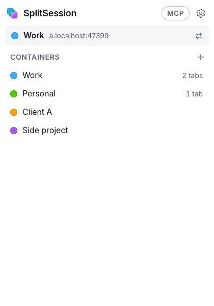
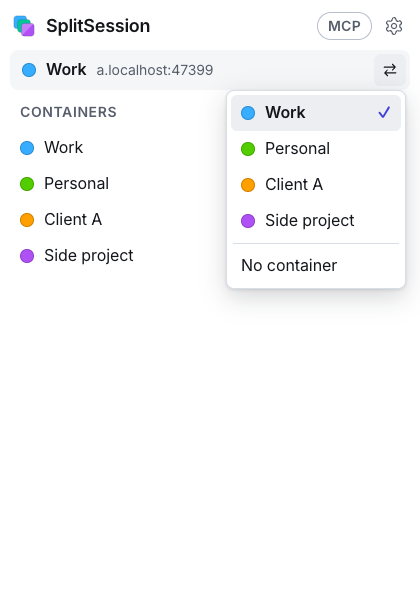
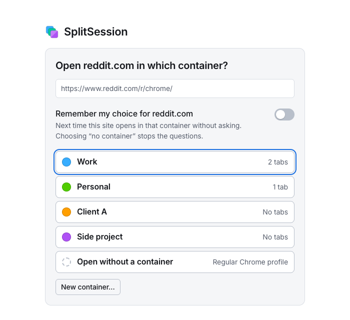

# Facet

Firefox-style containers for Chrome. Facet is an open-source Manifest V3 extension that lets you keep several accounts of the same site open **side by side, in different tabs of one Chrome profile**: two Reddit accounts, three Threads accounts, a work and a personal Supabase, all logged in at the same moment, without a second profile or a second browser.

Each container has its own cookies and its own page storage (localStorage, IndexedDB, caches, ...). A tab belongs to one container, and everything that tab does, on every site it visits, happens inside it.

*A 20-second demo GIF (three accounts of one site in one window, one tab group per container) belongs here; it has not been recorded yet. Still pictures are below and in `docs/screenshots/`.*

<p>
  
  
  
</p>

**Status: v0.1, in development.** The isolation engine and the interface are covered by an end-to-end suite that runs real Chromium against a local multi-host test stand. It has **not yet been verified on real sites** (see [Compatibility](#compatibility)). Read [what is and is not isolated](docs/limits.md) before trusting it with anything important.

## Why

Chrome profiles isolate everything, but they are separate windows with separate extensions and bookmarks, and an AI agent that drives "your browser" can only see one of them. Facet gives you the Firefox containers model inside one profile, and makes it easy for people and for agents to say "open this page as that account".

## Features

- **Containers**: create, rename, recolour (8 colours), delete. A container is a name, a colour and a cookie jar.
- **Popup**: shows which container the current tab is in, reopens it in another container (or none), opens a new tab in a container, manages the list.
- **Domain rules** (like Firefox's "Always open in"): per site, "always open in container X" or "ask me". The ask page can remember your choice.
- **Tab groups**: containers are shown as Chrome tab groups with the container's name and colour (optional; a group is only a view, dragging a tab out of it never changes its container).
- **Container tabs survive a restart**: with Chrome's "Continue where you left off", Reopen closed tab, History or a closed tab group opened again, container tabs come back in their container, held back until Facet has matched them. Tabs it cannot match with certainty wait for you in the popup.
- **Indicators**: a toolbar badge with the container's initials on its colour, the page title prefixed with `[name]`, `data-ctr="name"` on the page's `<html>` (the last two only while "Show the container name to pages" is on; it is off by default, AI agents need it on).
- **Strict mode** (default on, asks first): removes every service worker of the profile and stops sites from installing new ones, so none can answer a container tab with your regular logins.
- **Export and import** of containers and rules as JSON. Cookies are left out unless you tick a clearly marked box.
- **For AI agents**: `open.html?container=…&url=…`, a `#ctr=name` marker, a plain-text `state.html`; and an opt-in **agent bridge** that lets your own local agent (Claude Code) list, read and operate all your tabs through an MCP server. See [docs/agents.md](docs/agents.md).
- Light and dark theme. Every control is custom and keyboard accessible: no browser `<select>`, `alert` or validation bubbles.

## Install

Facet is not in the Chrome Web Store yet.

**From a release zip.** Unzip it and load the folder: `chrome://extensions` > turn on *Developer mode* > *Load unpacked*.

**From source** (Node 22+, pnpm 10):

```sh
pnpm install
pnpm build          # unpacked extension in .output/chrome-mv3
pnpm zip            # .output/facet-<version>-chrome.zip
```

then *Load unpacked* on `.output/chrome-mv3`. The extension ID is fixed (`hapfikidacgfgnnajkgnaednpgnhmffk`, see [docs/development.md](docs/development.md)), so `chrome-extension://hapfikidacgfgnnajkgnaednpgnhmffk/open.html` is the same address on every machine.

Facet asks for access to all sites: rewriting request headers per tab needs it. It sends nothing anywhere (the optional [agent bridge](#the-agent-bridge-off-by-default) opens a local, off-by-default channel to your own agent, and nothing else); containers and cookie jars live in `chrome.storage.local` on your machine, unencrypted (so does Chrome's own cookie store, and FileVault or the like is what protects both).

## How isolation works

1. A container is a property of a **tab** (`tabId -> container`), not of a site. Everything that tab requests, on any host, belongs to its container.
2. Each container has its own **cookie jar**. For the tabs of a container, `declarativeNetRequest` session rules replace the `Cookie` request header with the jar's cookies and strip `Set-Cookie` from responses, so the real profile's cookies are neither sent nor changed. The rules follow `SameSite`: a cross-site request gets only `SameSite=None` cookies, a cross-site top-level GET also `Lax` ones, never `Strict` ones.
3. `Set-Cookie` headers are read in `webRequest` (before the rules remove them) and stored in the container's jar; the rules are recompiled before the next request. A navigation that raced the update is detected by the `Cookie` header it actually carried and repeated once.
4. A script that runs **before the page's own scripts** (a synchronous "beacon" answered by a DNR rule tells it the container without any network traffic) namespaces `document.cookie`, `cookieStore`, `localStorage`, `sessionStorage`, IndexedDB, Cache Storage and `BroadcastChannel` per container. Pages can read the beacon too, so it never carries the container's ID, only an opaque key that differs per site.
5. Pages a container tab opens (`window.open`, `target=_blank`, Ctrl-click) are created blank, put into the same container, and only then navigated, so even the first request of an OAuth popup is isolated.
6. `open.html?container=…&url=…` puts a tab into a container before its first request; that is how the popup, domain rules and agents open pages.
7. Service workers and shared workers make requests outside every tab's rules, so they are switched off in containers. Strict mode (with your OK) removes every service worker of the profile and refuses new ones everywhere; without it, they are removed and refused on sites used in containers, and Facet removes a site's workers before it navigates a container tab there itself.
8. The real profile is never touched. A tab without a container is an ordinary Chrome tab.

The design is in [docs/PLAN.md](docs/PLAN.md) (Ukrainian), the decisions taken while building it in [docs/decisions.md](docs/decisions.md).

## Isolated, and not

| | |
| --- | --- |
| Isolated | Network cookies of the whole tab (top frame, iframes, fetch/XHR, WebSocket handshakes, dedicated workers), with `SameSite` honoured for cross-site requests; `document.cookie`, `cookieStore`, `localStorage`, `sessionStorage`, IndexedDB, Cache Storage, `BroadcastChannel`, also in same-origin frames, `<object>` documents and sandboxed frames whose scripts are disabled; popups and links opened from a container tab; several accounts of one site at once; restarts of the extension's service worker |
| Switched off in containers | `SharedWorker`; service workers. Strict mode (after your OK): service workers removed and refused in the whole profile, their scripts blocked at the network level, and requests outside tabs to container sites sent without cookies |
| Not isolated | The **first request** of a tab Facet did not open itself (context-menu "open in new tab", `#ctr=`, a domain rule that moves a tab); without strict mode, a site's service worker of the real profile may answer a container tab's first visit through a plain link; **a site that deliberately polls its own same-origin iframe while it navigates can read the real profile's cookies and that origin's storage of other containers in the instant before Facet's scripts run in the new document** (no extension API closes this; it links accounts on that site only); `SameSite=None` cookies on cross-site requests made with `credentials: 'omit'`; HTTP cache, HTTP auth, client certificates, fingerprint, saved passwords, history, state inside dedicated workers, `Path` of cookies |
| Seen by pages | An opaque per-site key (never the container ID); the container name only while "Show the container name to pages" is on (off by default; AI agents need it on) |
| After a browser restart | Container tabs come back in their containers, background tabs before their first request; the tab that was active in each window (and pinned tabs) may send one request as the real profile first, because Chrome loads them before extension rules apply; uncertain matches wait for your choice in the popup |

The complete, honest list, with the mechanism behind each item, is [docs/limits.md](docs/limits.md).

## For AI agents

```text
chrome-extension://hapfikidacgfgnnajkgnaednpgnhmffk/open.html?container=Work&url=https%3A%2F%2Fexample.com%2F   (navigate a tab here: it opens in container "Work", created if new)
https://example.com/#ctr=Work                                                                                       (marker form: container must exist, tab must have none, navigation started by the browser or an extension)
chrome-extension://hapfikidacgfgnnajkgnaednpgnhmffk/state.html                                                       (plain text: containers, container tabs, ready-to-copy addresses)
```

### The agent bridge (off by default)

A local MCP server lets Claude Code (running on your Mac) see your Chrome tabs across all windows, each with its container, and operate them like a Playwright-class agent: accessibility snapshots with element refs, real (trusted) clicks, typing and key presses, hover, drag and drop, select boxes, file uploads, JavaScript dialogs, `run_js` under any page CSP, screenshots of background tabs without switching to them, console and network recording, viewport sizes, and opening pages in a container. It uses Chrome's debugger (`chrome.debugger`), only while the switch is on and a tool works on a tab; Chrome shows its "started debugging this browser" bar meanwhile, and its Cancel takes the debugger back. It is **one all-or-nothing switch** ("Agent bridge" in the popup): off, nothing is reachable; on, **the agent can do everything in every tab, logged-in pages included**, and every tab's toolbar badge turns amber ("ON", or the container's initials on amber). The popup says "Agent connected — full access" and lists the agent's last five actions. Whatever tab the agent reads or operates shows it (a glowing frame and an "Agent: reading" label on the page, an animated eye in the tab title while it reads, a pulsing ring around the tab's favicon, "AI" on the toolbar button), then fades; "Show agent activity" in the settings turns that off. Container isolation still holds for the pages: the debugger is never used to read or set cookies, headers or storage, and navigations go through Facet's own paths.

```sh
pnpm bridge:install                  # 1. builds the bridge, registers the Chrome native host, prints step 2
claude mcp add --scope user facet -- <node> <repo>/bridge/dist/facet-bridge.mjs mcp   # 2. (printed by step 1; run it yourself)
# 3. flip "Agent bridge" in the Facet popup
```

Chrome's Native Messaging connects the extension to a local host (pinned to Facet's extension ID); the MCP server talks to the host over a private Unix socket (0600), never a network port. Details, tool list and limits: [docs/agents.md](docs/agents.md#7-the-agent-bridge-your-own-agent-drives-your-chrome-tabs-opt-in).

### Without the bridge

First switch on **"Show the container name to pages (for AI agents)"** in Facet's settings (off by default, because any page can read the name). Then container tabs have a `[Work] ` title prefix (so `tabs_context` shows which account is which) and `data-ctr="Work"` on `<html>`. Details for Claude in Chrome and Playwright: [docs/agents.md](docs/agents.md).

## Compatibility

Everything in this table is **not yet verified on real sites**. What is verified is the behaviour of the engine against a local stand that imitates the patterns these sites use (302 and XHR logins, HttpOnly session cookies, cross-domain OAuth by redirect and by popup, cross-origin iframes). Real sites also bring service workers, anti-abuse checks and fingerprinting that the stand does not have, and some of them may well notice two sessions from one browser.

| Site | Two accounts side by side | Notes |
| --- | --- | --- |
| Reddit | not yet verified on real sites | |
| Threads (and Instagram / Facebook hops) | not yet verified on real sites | whole-tab isolation exists for exactly this: the login hops across several domains |
| Supabase (and GitHub / Google OAuth) | not yet verified on real sites | |
| GitHub | not yet verified on real sites | |
| Google accounts | not yet verified on real sites | Google ties sessions to more than cookies |

A dated manual matrix will replace this table once it exists.

## Development

```sh
pnpm install
pnpm typecheck      # tsc for src and e2e
pnpm test           # unit tests (Vitest)
pnpm build          # unpacked extension in .output/chrome-mv3
pnpm e2e            # build (extension and agent bridge), then the Playwright suite in real Chromium against the local stand
pnpm zip            # release zip in .output/
pnpm bridge:build   # the agent bridge alone (bridge/dist/); bridge:install / bridge:uninstall register it with Chrome
pnpm dev            # WXT dev mode with a throwaway Chrome profile
```

The end-to-end tests need Playwright's Chromium once (`pnpm exec playwright install chromium`). More in [docs/development.md](docs/development.md).

## License

[MIT](LICENSE).
